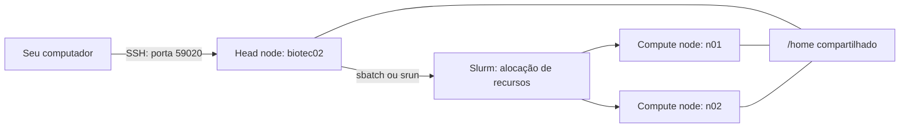

# Aula: acesso ao servidor HPC e uso do Slurm

Material de apoio para novos usuários e pesquisadores do laboratório. Ao concluir a aula, você deverá conseguir conectar ao servidor, configurar uma chave SSH, trabalhar com uma IDE remota e executar análises nos nós de computação usando o Slurm.

**Servidor de acesso:** `biotec02.esalq.usp.br` · **Porta SSH:** `59020` · **Edição:** novembro de 2026.

Substitua `seu_usuario` pelo login fornecido pelo laboratório e `seu_email@usp.br` pelo seu e-mail. Esses textos são exemplos, não credenciais de acesso.

## Arquivos dos exercícios

Os scripts completos estão em [exemplos/](exemplos/): [primeiro job](exemplos/primeiro_job.sh), [alinhamento BWA](exemplos/rodar_analise.sh) e [array FastQC](exemplos/qc_array.sh). Há também uma [lista com três amostras](exemplos/lista_amostras.txt).

Para utilizá-los, copie os arquivos `.sh` para a pasta `scripts/` do seu projeto e a lista de amostras para a raiz do projeto. Submeta os jobs a partir dessa raiz, conforme as instruções abaixo. Os exemplos de bioinformática exigem os dados e ambientes indicados em cada seção.

## Sumário

- [1. Entenda onde o trabalho acontece](#1-entenda-onde-o-trabalho-acontece)
- [2. Faça o primeiro acesso](#2-faça-o-primeiro-acesso)
- [3. Configure uma chave SSH](#3-configure-uma-chave-ssh)
- [4. Crie o atalho biotec02](#4-crie-o-atalho-biotec02)
- [5. Copie arquivos](#5-copie-arquivos)
- [6. Conecte a IDE](#6-conecte-a-ide)
- [7. Organize o projeto e o ambiente](#7-organize-o-projeto-e-o-ambiente)
- [8. Entenda o Slurm e as filas](#8-entenda-o-slurm-e-as-filas)
- [9. Escolha os recursos do job](#9-escolha-os-recursos-do-job)
- [10. Prática: submeta seu primeiro job](#10-prática-submeta-seu-primeiro-job)
- [11. Acompanhe a execução](#11-acompanhe-a-execução)
- [12. Abra uma sessão interativa](#12-abra-uma-sessão-interativa)
- [13. Exemplo: alinhamento com BWA](#13-exemplo-alinhamento-com-bwa)
- [14. Exemplo: várias amostras com job arrays](#14-exemplo-várias-amostras-com-job-arrays)
- [15. Dependências, GPU e execução direta](#15-dependências-gpu-e-execução-direta)
- [16. Resolva problemas comuns](#16-resolva-problemas-comuns)
- [17. Checklist da aula](#17-checklist-da-aula)
- [Referências](#referências)

## 1. Entenda onde o trabalho acontece

**`biotec02` é o head node**, também chamado de nó de acesso ou login. É nele que você entra por SSH, edita scripts, usa a IDE e submete jobs. **`n01` e `n02` são os nós de computação**, onde as análises pesadas executam após a alocação pelo Slurm.



| Componente | Recursos informados no material da aula | Uso |
| --- | --- | --- |
| Head node (`biotec02`) | 96 CPUs, AMD EPYC 7352, ~251 GB RAM | Acesso, edição, organização e submissão |
| Compute node (`n01`) | 192 CPUs/threads, ~2 TB RAM, 1 GPU | Execução de análises via Slurm |
| Compute node (`n02`) | 192 CPUs/threads, ~2 TB RAM, 1 GPU | Execução de análises via Slurm |
| `/home` compartilhado | ~88 TB totais | Arquivos visíveis nos três nós |

Os valores representam a infraestrutura descrita no material do laboratório, não recursos livres garantidos para cada usuário. O compartilhamento de `/home` dispensa copiar os dados do head node para os nós de computação.

> **Regra do laboratório:** análises pesadas devem ser executadas via Slurm. Não rode alinhamentos, montagens ou scripts que consomem muita CPU/RAM diretamente no head node.

Nos exemplos abaixo, **computador pessoal** significa o terminal local, antes de entrar por SSH. **Head node** significa o terminal depois do login no `biotec02`. Os comandos executados no servidor usam Bash, mesmo quando a conexão foi iniciada pelo PowerShell.

## 2. Faça o primeiro acesso

### Pré-requisitos

Você precisa de uma conta ativa no servidor, senha inicial e um cliente OpenSSH no computador. No Linux/macOS, abra o Terminal; no Windows, abra o PowerShell ou o terminal do WSL.

**No computador pessoal**, confira se o cliente está disponível:

```bash
ssh -V
```

O mesmo comando funciona no PowerShell. Se `ssh` não for reconhecido no Windows, habilite o recurso **Cliente OpenSSH**, conforme a documentação da Microsoft nas referências.

### Login

**No computador pessoal**, execute:

```bash
ssh -p 59020 seu_usuario@biotec02.esalq.usp.br
```

No primeiro acesso, confira a impressão digital da chave do servidor com a administração do laboratório antes de responder `yes`. Depois, digite a senha e pressione Enter. É normal que nenhum caractere ou asterisco apareça durante a digitação.

**Depois de entrar no head node**, confira sua sessão:

```bash
hostname
whoami
pwd
```

O nome do host deverá identificar o `biotec02`. Para encerrar a conexão e voltar ao terminal local:

```bash
exit
```

## 3. Configure uma chave SSH

O par de chaves permite autenticar o computador sem digitar a senha da conta remota a cada conexão. A chave privada fica no computador pessoal; somente a chave pública é instalada no servidor.

| Arquivo | Onde fica | Pode compartilhar? |
| --- | --- | --- |
| `id_ed25519` | Computador pessoal | Não: é a chave privada |
| `id_ed25519.pub` | Computador pessoal; conteúdo instalado no servidor | Sim: é a chave pública |

### Gerar a chave

**No computador pessoal**, fora da sessão SSH:

```bash
ssh-keygen -t ed25519 -C "seu_email@usp.br"
```

O comando também funciona no PowerShell. Aceite o caminho padrão se ainda não houver uma chave nesse local. Se o programa perguntar se deseja sobrescrever uma chave existente, preserve-a e verifique se ela já pode ser utilizada. Defina uma frase-senha para proteger a chave privada.

A frase-senha da chave é diferente da senha da conta no servidor. Um agente SSH pode manter a chave desbloqueada durante a sessão, evitando solicitações repetidas da frase-senha.

### Linux, macOS ou WSL: instalar a chave pública

**No computador pessoal**, execute:

```bash
ssh-copy-id -p 59020 -i ~/.ssh/id_ed25519.pub \
  seu_usuario@biotec02.esalq.usp.br
```

Informe a senha da conta remota quando solicitada. O comando adiciona a chave pública ao arquivo `~/.ssh/authorized_keys` no servidor.

Se `ssh-copy-id` não estiver disponível, esta alternativa usa o cliente SSH:

```bash
cat ~/.ssh/id_ed25519.pub | ssh -p 59020 \
  seu_usuario@biotec02.esalq.usp.br \
  'umask 077; mkdir -p ~/.ssh && cat >> ~/.ssh/authorized_keys && chmod 700 ~/.ssh && chmod 600 ~/.ssh/authorized_keys'
```

### Windows PowerShell: instalar a chave pública

**No PowerShell do computador pessoal**, depois de gerar a chave:

```powershell
Get-Content "$env:USERPROFILE\.ssh\id_ed25519.pub" | ssh `
  -p 59020 `
  seu_usuario@biotec02.esalq.usp.br `
  'umask 077; mkdir -p ~/.ssh && cat >> ~/.ssh/authorized_keys && chmod 700 ~/.ssh && chmod 600 ~/.ssh/authorized_keys'
```

O comando lê o arquivo público local e envia seu conteúdo ao servidor por SSH. A sequência entre aspas simples é executada pelo shell Linux remoto. A pasta `.ssh` recebe permissão `700`, e `authorized_keys`, permissão `600`. Execute a instalação uma vez por chave; a alternativa manual pode acrescentar linhas duplicadas se repetida.

### Como quebrar comandos em várias linhas

| Terminal | Continuação de linha |
| --- | --- |
| Bash: Linux, macOS, WSL e terminal do servidor | Barra invertida: `\` |
| PowerShell: terminal local do Windows | Acento grave: `` ` `` |

O caractere de continuação deve ser o último da linha, **sem espaços depois dele**. Uma barra invertida não substitui o acento grave no PowerShell. Nos comandos remotos, escreva `~/.ssh`, sem uma barra invertida antes do `~`.

### Testar a autenticação

**No computador pessoal**:

```bash
ssh -p 59020 seu_usuario@biotec02.esalq.usp.br
```

Se a chave estiver protegida e ainda não tiver sido desbloqueada pelo agente SSH, você poderá receber uma solicitação da frase-senha. Após conferir o acesso, use `exit` para voltar ao terminal local.

## 4. Crie o atalho biotec02

**No computador pessoal**, edite o arquivo de configuração do cliente SSH:

- Linux/macOS/WSL: `~/.ssh/config`.
- Windows PowerShell: `$env:USERPROFILE\.ssh\config`.

No PowerShell, você pode abrir o arquivo com:

```powershell
notepad "$env:USERPROFILE\.ssh\config"
```

Salve o arquivo como `config`, sem a extensão `.txt`. Insira este conteúdo, ajustando o usuário:

```ssh-config
Host biotec02
    HostName biotec02.esalq.usp.br
    Port 59020
    User seu_usuario
    IdentityFile ~/.ssh/id_ed25519
    ServerAliveInterval 60
```

Agora a conexão local pode ser feita com:

```bash
ssh biotec02
```

O cliente lê o endereço, o usuário, a porta e o caminho da chave no arquivo de configuração. Use as chaves e o arquivo `config` do mesmo cliente: o OpenSSH do Windows e o OpenSSH dentro do WSL podem usar diretórios pessoais diferentes.

## 5. Copie arquivos

**No computador pessoal**, usando o atalho configurado:

```bash
# Crie o destino no servidor.
ssh biotec02 'mkdir -p ~/meu_projeto'

# Envie um arquivo local.
scp arquivo.tsv biotec02:~/meu_projeto/

# Baixe esse arquivo para a pasta local atual.
scp biotec02:~/meu_projeto/arquivo.tsv .
```

Sem o atalho, informe a porta explicitamente:

```bash
scp -P 59020 arquivo.tsv seu_usuario@biotec02.esalq.usp.br:~/meu_projeto/
```

No `ssh` e no `ssh-copy-id`, a porta usa **`-p` minúsculo**. No `scp`, usa **`-P` maiúsculo**. Esses exemplos de `scp` também funcionam no PowerShell com arquivos na pasta local atual.

## 6. Conecte a IDE

Uma IDE reúne editor, explorador de arquivos e terminal. O exemplo da aula usa **VS Code com Remote - SSH**; os recursos de outras IDEs variam conforme o produto e suas extensões.

**No computador pessoal**:

1. Abra o VS Code e instale a extensão **Remote - SSH**, da Microsoft.
2. Abra a paleta de comandos e escolha **Remote-SSH: Connect to Host...**.
3. Selecione `biotec02`, definido no arquivo `config`.
4. Se solicitado, indique que o servidor remoto é Linux.
5. Use **Open Folder** para abrir a pasta do seu projeto em `/home/seu_usuario/`.

Confira o indicador de conexão remota e execute `hostname` no terminal integrado. Na sessão padrão, os arquivos, extensões remotas e terminal estão no **head node (`biotec02`)**.

**Editar um script na IDE não o envia ao Slurm.** Executá-lo pelo botão Run/Play pode iniciar a análise diretamente no head node. Salve o script e submeta-o com `sbatch`, ou solicite uma sessão interativa com `srun`.

Abra apenas a pasta do projeto em uso para limitar indexação desnecessária e instale somente as extensões remotas de que precisar.

## 7. Organize o projeto e o ambiente

**No head node**, prepare a estrutura para a prática:

```bash
mkdir -p ~/meu_projeto
cd ~/meu_projeto
mkdir -p data/raw data/processed scripts results logs
```

Estrutura sugerida:

```text
meu_projeto/
├── data/
│   ├── raw/          # Entradas originais: não modificar
│   └── processed/    # Dados derivados
├── scripts/         # Scripts e arquivos sbatch
├── results/         # Resultados da análise
├── logs/            # Saída padrão e mensagens de erro
└── .gitignore
```

Os próximos exemplos presumem que você está na raiz `~/meu_projeto`. Os caminhos dos scripts serão relativos a essa pasta. O Slurm normalmente inicia o job no diretório de submissão; use `--chdir` se precisar defini-lo explicitamente.

Antes de instalar software, confira os módulos disponíveis, testando nomes em maiúsculas e minúsculas:

```bash
module avail
module avail bwa
module avail BWA
module avail fastqc
module avail FastQC
```

Use o nome e a versão efetivamente listados para carregar um módulo. Para ambientes Conda, o laboratório prefere `mamba`. A inicialização do shell e os nomes dos ambientes dependem da instalação local: configure o carregamento também no script de submissão e confirme que o executável está disponível no nó de computação.

Registre versões das ferramentas nos logs e sementes aleatórias nas análises estocásticas. Preserve `data/raw/`, mantenha saídas em `data/processed/` ou `results/` e exclua arquivos grandes, dados e chaves privadas do versionamento Git.

## 8. Entenda o Slurm e as filas

O Slurm recebe pedidos de recursos, organiza a espera e executa jobs quando há recursos e permissão de acordo com as políticas do cluster. O controlador `slurmctld` agenda as tarefas; os agentes `slurmd` atuam nos nós de computação. Quando configurado, `slurmdbd` fornece contabilização e histórico.

As filas, chamadas **partitions**, compartilham os nós `n01` e `n02`. A configuração descrita no material do laboratório é:

| Fila | Tempo máximo | PriorityTier | Uso e restrições |
| --- | --- | --- | --- |
| `short` | 24 horas (`1-00:00:00`) | 30 | Padrão; tarefas de até um dia |
| `long` | 30 dias (`30-00:00:00`) | 20 | Pipelines e análises prolongadas |
| `bigmem` | 30 dias (`30-00:00:00`) | 20 | Análises com alta demanda de memória |
| `long50` | 122 dias (`122-00:00:00`) | 50 | Acesso restrito ao grupo `long50p` |
| `teste` | 1 minuto (`00:01:00`) | 30 | Validação rápida; máximo de 3 CPUs por nó |

Esses limites podem mudar. **No head node**, consulte a configuração vigente:

```bash
sinfo
scontrol show partition short
scontrol show partition teste
```

O asterisco em `short*`, quando exibido por `sinfo`, identifica a fila padrão; ele não faz parte do nome usado em `--partition=short`. O PriorityTier influencia o agendamento, mas não garante início imediato.

## 9. Escolha os recursos do job

| Opção | O que solicita ou define | Exemplo |
| --- | --- | --- |
| `--partition` | Fila | `--partition=short` |
| `--job-name` | Nome para identificação | `--job-name=alinhamento` |
| `--nodes` | Quantidade de nós | `--nodes=1` |
| `--ntasks` | Quantidade de tarefas/processos, por exemplo em MPI | `--ntasks=1` |
| `--cpus-per-task` | CPUs alocadas por tarefa | `--cpus-per-task=8` |
| `--mem` | Memória solicitada por nó | `--mem=32G` |
| `--mem-per-cpu` | Memória por CPU alocada; alternativa a `--mem` | `--mem-per-cpu=4G` |
| `--time` | Limite de duração | `--time=04:00:00` |
| `--output` | Arquivo de saída padrão | `--output=logs/run_%j.out` |
| `--error` | Arquivo de erros | `--error=logs/run_%j.err` |

Para um programa multithread em um nó, um pedido comum é **1 nó, 1 tarefa e 8 CPUs por tarefa**. O programa também precisa receber sua própria opção de threads, por exemplo `-t "${SLURM_CPUS_PER_TASK}"`. Reservar oito CPUs não paraleliza automaticamente um código serial.

Use `--mem` **ou** `--mem-per-cpu`, não as duas opções juntas. Com oito CPUs em um nó, `--mem-per-cpu=4G` corresponde a 32G nesse nó. O significado de CPU física ou thread lógica depende da configuração do cluster.

Em arquivos de log, `%j` é substituído pelo ID do job. **Crie a pasta `logs/` antes de executar `sbatch`**: o Slurm precisa abrir os arquivos de log antes de iniciar o corpo do script.

## 10. Prática: submeta seu primeiro job

Este exercício usa apenas comandos básicos do sistema, sem arquivos de dados ou ferramentas de bioinformática.

**No head node, na raiz de `~/meu_projeto`**, crie `scripts/primeiro_job.sh` na IDE ou no editor de texto com este conteúdo:

```bash
#!/bin/bash
#SBATCH --job-name=primeiro_job
#SBATCH --partition=teste
#SBATCH --nodes=1
#SBATCH --ntasks=1
#SBATCH --cpus-per-task=1
#SBATCH --mem=256M
#SBATCH --time=00:01:00
#SBATCH --output=logs/primeiro_%j.out
#SBATCH --error=logs/primeiro_%j.err

set -euo pipefail
echo "Início: $(date)"
echo "Job: ${SLURM_JOB_ID}"
echo "Nó: $(hostname)"
echo "Diretório: $(pwd)"
echo "CPUs por tarefa: ${SLURM_CPUS_PER_TASK}"
echo "Bash: ${BASH_VERSION}"
sleep 5
echo "Fim: $(date)"
```

As diretivas `#SBATCH` ficam antes dos comandos executáveis. Não coloque `mkdir`, ativação de ambientes ou outros comandos antes delas. Grave scripts com finais de linha Linux (**LF**), especialmente se editar no Windows.

**No terminal do head node**, submeta:

```bash
mkdir -p logs
sbatch scripts/primeiro_job.sh
```

Você receberá uma mensagem como:

```text
Submitted batch job 12345
```

Guarde o ID retornado. O número `12345` é apenas ilustrativo: substitua-o nos exemplos seguintes. A submissão aceita não significa que o job já começou a executar.

Depois da execução, leia o log:

```bash
cat logs/primeiro_12345.out
cat logs/primeiro_12345.err
```

O log deve indicar `n01` ou `n02`, o ID do job e as datas de início e fim. Um arquivo de erro vazio é normal para esse exercício. Se a fila `teste` tiver sido alterada, confira os limites atuais antes de adaptar o pedido.

## 11. Acompanhe a execução

**No head node**, substituindo `12345` pelo ID real:

| Objetivo | Comando |
| --- | --- |
| Ver seus jobs | `squeue -u "$USER"` |
| Ver detalhes de um job | `scontrol show job 12345` |
| Cancelar um job | `scancel 12345` |
| Ver filas e nós | `sinfo` |
| Consultar histórico | `sacct -j 12345 --format=JobID,State,Elapsed,MaxRSS` |
| Consultar consumo do step batch em execução | `sstat --jobs=12345.batch --format=JobID,AveCPU,MaxRSS` |

No `squeue`, `PD` indica que o job aguarda e `R`, que está executando. Um job muito curto pode terminar antes da consulta e desaparecer da fila; consulte `sacct` e os logs.

As métricas de `sstat` e `sacct` dependem da coleta habilitada no cluster. `MaxRSS` pode aparecer nos registros dos steps, como `.batch`, e não na linha principal do job. Use o histórico para ajustar tempo e memória nas próximas submissões.

## 12. Abra uma sessão interativa

**No head node**, solicite um terminal de computação para testar ou depurar códigos:

```bash
srun --partition=short \
  --nodes=1 --ntasks=1 \
  --cpus-per-task=4 --mem=16G \
  --time=02:00:00 --pty bash
```

Aguarde a alocação. **Dentro da sessão interativa**, confirme o nó:

```bash
hostname
```

O resultado deve identificar `n01` ou `n02`. Carregue o ambiente necessário e faça seus testes dentro dessa sessão. Para sair e liberar os recursos:

```bash
exit
```

Mesmo se você abriu a conexão pelo PowerShell, esses comandos usam `\` porque estão sendo digitados no Bash do servidor.

## 13. Exemplo: alinhamento com BWA

Este exemplo exige BWA disponível no ambiente de execução, a referência `data/raw/ref.fa` com os índices exigidos pelo BWA e o arquivo `data/raw/sample1.fq.gz`. O exemplo é **single-end**; para paired-end, passe os dois FASTQs ao programa. A preparação pesada de referências e índices também deve passar pelo Slurm.

**No head node**, crie `scripts/rodar_analise.sh`:

```bash
#!/bin/bash
#SBATCH --job-name=alinhamento_bwa
#SBATCH --partition=short
#SBATCH --nodes=1
#SBATCH --ntasks=1
#SBATCH --cpus-per-task=8
#SBATCH --mem=32G
#SBATCH --time=04:00:00
#SBATCH --output=logs/bwa_%j.out
#SBATCH --error=logs/bwa_%j.err

set -euo pipefail
echo "Início: $(date) | Nó: $(hostname) | Job: ${SLURM_JOB_ID}"

# Carregue aqui o módulo ou ambiente disponível no laboratório.
# Exemplo, somente se esse módulo existir: module load bwa
command -v bwa
bwa 2>&1 | head -n 5 || true

bwa mem -t "${SLURM_CPUS_PER_TASK}" \
  data/raw/ref.fa data/raw/sample1.fq.gz \
  > results/sample1.sam

echo "Fim com sucesso: $(date)"
```

Adapte o carregamento do software antes de submeter. A partir da raiz do projeto:

```bash
mkdir -p logs results
sbatch scripts/rodar_analise.sh
```

`set -euo pipefail` ajuda a interromper o script em falhas. A consulta à versão do BWA usa `|| true` porque sua exibição de ajuda pode retornar um código diferente de zero; o comando de alinhamento não ignora falhas.

## 14. Exemplo: várias amostras com job arrays

Use **job arrays** para executar a mesma análise em várias amostras. Cada tarefa recebe um índice em `SLURM_ARRAY_TASK_ID`, que pode selecionar uma linha de uma lista de entradas.

**No head node**, crie `lista_amostras.txt` na raiz do projeto, com um identificador por linha, sem cabeçalho, extensão ou linhas vazias. Exemplo completo com três amostras:

```text
amostra_01
amostra_02
amostra_03
```

Os arquivos correspondentes devem existir em `data/raw/amostra_01.fastq.gz`, `data/raw/amostra_02.fastq.gz` e `data/raw/amostra_03.fastq.gz`. Salve a lista com finais de linha LF.

Crie `scripts/qc_array.sh`:

```bash
#!/bin/bash
#SBATCH --job-name=qc_array
#SBATCH --partition=short
#SBATCH --nodes=1
#SBATCH --ntasks=1
#SBATCH --cpus-per-task=4
#SBATCH --mem=8G
#SBATCH --time=02:00:00
#SBATCH --array=1-3%2
#SBATCH --output=logs/qc_%A_%a.out
#SBATCH --error=logs/qc_%A_%a.err

set -euo pipefail
# Carregue aqui o módulo ou ambiente que disponibiliza fastqc.
command -v fastqc
fastqc --version

AMOSTRA=$(sed -n "${SLURM_ARRAY_TASK_ID}p" lista_amostras.txt)
: "${AMOSTRA:?Linha vazia ou inexistente na lista de amostras}"

echo "Amostra: ${AMOSTRA} | Tarefa: ${SLURM_ARRAY_TASK_ID}"
echo "Nó: $(hostname) | Início: $(date)"
fastqc -t "${SLURM_CPUS_PER_TASK}" \
  "data/raw/${AMOSTRA}.fastq.gz" \
  -o results/fastqc/
echo "Fim: $(date)"
```

Prepare o ambiente do FastQC e submeta **no head node, na raiz do projeto**:

```bash
mkdir -p logs results/fastqc
sbatch scripts/qc_array.sh
```

`--array=1-3%2` cria três tarefas e limita a execução a duas simultâneas. Para uma lista com **50 amostras**, altere para `--array=1-50%10`: serão até dez tarefas simultâneas, conforme a disponibilidade. Os recursos são pedidos **por tarefa**; dez tarefas com quatro CPUs e 8G podem usar, juntas, 40 CPUs e 80G.

Nos logs, `%A` representa o ID principal do array e `%a`, o índice da tarefa. Por exemplo: `qc_12345_2.out`. O FastQC pode usar menos CPUs do que as reservadas para uma tarefa com um único arquivo; ajuste o pedido conforme a ferramenta e a carga real.

## 15. Dependências, GPU e execução direta

### Executar uma etapa depois de outra

**No head node**, se `scripts/proxima_etapa.sh` já existir e o job anterior tiver ID `12345`:

```bash
sbatch --dependency=afterok:12345 scripts/proxima_etapa.sh
```

A condição `afterok` permite iniciar a próxima etapa após o término bem-sucedido do job anterior. A nova etapa ainda precisa aguardar recursos disponíveis.

### Solicitar GPU ou nó específico

Acrescente ao cabeçalho do script, quando necessário:

```bash
#SBATCH --gres=gpu:1
#SBATCH --nodelist=n02
```

As opções são independentes. Solicite GPU apenas se a análise realmente a utilizar e restrinja o nó somente quando houver uma necessidade concreta; a disponibilidade e a configuração de GPU dependem do cluster.

### Executar Beagle com srun

O exemplo abaixo pressupõe Java e `scripts/beagle.jar` disponíveis e a entrada `data/raw/genotipos.vcf.gz`. **No head node, na raiz do projeto**:

```bash
mkdir -p logs results
srun --partition=long \
  --nodes=1 --ntasks=1 \
  --cpus-per-task=32 --mem=128G \
  --time=1-00:00:00 --job-name=runBeagle \
  --output=logs/runBeagle_%j.out \
  --error=logs/runBeagle_%j.err \
  java -Xmx110g -jar scripts/beagle.jar \
  gt=data/raw/genotipos.vcf.gz \
  out=results/imputado nthreads=32
```

`nthreads=32` acompanha as 32 CPUs solicitadas. O limite de heap Java (`-Xmx110g`) deixa margem dentro dos 128G reservados para memória usada fora do heap. Registre a versão do Java e a versão do Beagle utilizada na análise. Para uma execução prolongada que deva seguir independentemente da sessão do terminal, coloque o comando em um script e use `sbatch`.

## 16. Resolva problemas comuns

| Situação | O que conferir |
| --- | --- |
| SSH não conecta | Endereço, conectividade e `-p 59020`; com o atalho, verifique `Port 59020` no `config` |
| `ssh` não é reconhecido no Windows | Disponibilidade do Cliente OpenSSH |
| Continua pedindo senha da conta | Usuário, chave instalada, caminho de `IdentityFile` e permissões de `.ssh`/`authorized_keys` |
| Pede frase-senha da chave | A chave está protegida; desbloqueie-a ou use o agente SSH configurado no seu sistema |
| `scp` tenta usar a porta errada | Use `-P 59020` ou o atalho `biotec02` |
| PowerShell falha ao colar várias linhas | Use acento grave, sem espaços depois; não use `\` como continuação |
| Identidade do host mudou | Confirme a mudança com a administração antes de alterar `known_hosts` |
| Job permanece em `PD` | Consulte o motivo no `squeue` e os detalhes em `scontrol show job ID` |
| Job não aparece mais no `squeue` | Pode ter terminado; consulte `sacct` e os logs |
| Logs não foram criados | Confirme que `logs/` existia antes da submissão e que você submeteu na pasta correta |
| `command not found` no job | Carregue o módulo/ambiente no script e confira o executável no nó de computação |
| Arquivo de entrada não encontrado | Diretório de submissão, caminhos relativos e nomes dos arquivos |
| Erro de finais de linha DOS/Windows | Salve scripts e listas como LF no editor |
| Estado `OUT_OF_MEMORY` ou `TIMEOUT` | Revise logs, consumo observado e limites pedidos antes de reenviar |

## 17. Checklist da aula

- [ ] Consegui conectar ao head node pela porta `59020`.
- [ ] Sei distinguir o computador pessoal, o head node e os nós de computação.
- [ ] Instalei somente a chave pública e testei a autenticação.
- [ ] Configurei `ssh biotec02` com `Port 59020`.
- [ ] Sei quando usar `\` no Bash e acento grave no PowerShell.
- [ ] Conectei a IDE e confirmei o host do terminal remoto.
- [ ] Organizei o projeto e criei `logs/` antes da submissão.
- [ ] Submeti o primeiro job, guardei o ID e consultei os logs.
- [ ] Confirmei que o primeiro job executou em `n01` ou `n02`.
- [ ] Sei ajustar CPU, RAM, tempo e concorrência de um array.

## Referências

Os dados de hardware, filas e regras locais foram adaptados do material **Onboarding Servidor e Slurm 2026** do laboratório. A porta `59020` foi confirmada pelo responsável pela aula. A configuração atual do cluster deve ser consultada com as ferramentas indicadas no guia.

Documentação para consulta:

- [OpenSSH: cliente ssh](https://man.openbsd.org/ssh) e [geração de chaves](https://man.openbsd.org/ssh-keygen).
- [Manual do ssh-copy-id](https://man7.org/linux/man-pages/man1/ssh-copy-id.1.html).
- [OpenSSH: transferência com scp](https://man.openbsd.org/scp).
- [Microsoft: instalação do OpenSSH no Windows](https://learn.microsoft.com/en-us/windows-server/administration/openssh/openssh_install_firstuse).
- [Microsoft: sintaxe e continuação de linhas no PowerShell](https://learn.microsoft.com/en-us/powershell/module/microsoft.powershell.core/about/about_parsing).
- [VS Code: desenvolvimento remoto via SSH](https://code.visualstudio.com/docs/remote/ssh).
- [Slurm: sbatch](https://slurm.schedmd.com/sbatch.html), [srun](https://slurm.schedmd.com/srun.html) e [job arrays](https://slurm.schedmd.com/job_array.html).
- [Slurm: histórico com sacct](https://slurm.schedmd.com/sacct.html) e [monitoramento com sstat](https://slurm.schedmd.com/sstat.html).

O guia é autocontido: este arquivo pode ser usado como `README.md` na raiz do repositório da aula. Os exemplos de BWA, FastQC e Beagle exigem seus respectivos dados e ambientes; o exercício de primeiro job usa somente comandos básicos do sistema.
